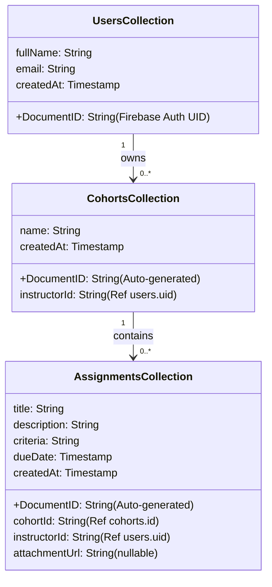

# Assignment #3: Database Design (Team 05)

## 1. Database Selection and Justification (Why Firebase Firestore?)

For the Learning Platform-Assignment system, our team selected Firebase Firestore as our remote database based on the following key reasons:

* **Alignment with 100% Backend-as-a-Service (BaaS) and Zero-Budget Constraint:**  
  The system architecture is completely client-driven; the React frontend application communicates directly with the database via the Firebase Client SDK. This eliminates the operational overhead, maintenance burden, and server costs of hosting a dedicated custom REST API. The entire workload operates within the Firebase Spark Plan (Free Tier), perfectly fulfilling our project’s $0 deployment constraint.

* **Well-Suited Flat Document Model:**  
  The domain entity structure is clean and linear: User (Instructor) -> Cohort -> Assignment. A NoSQL document-oriented model provides low latency for reading collections and batch writing, eliminating the need for complex relational multi-table joins.

* **Engine-Level Security via Firestore Security Rules:**  
  Because client applications interface directly with the database, security and data isolation are enforced at the database engine level via Firestore Security Rules. Rules validate that `request.auth.uid` strictly matches the owner ID, ensuring one instructor cannot read, modify, or delete another instructor's cohorts or assignments.

* **Offline Persistence and Realtime Synchronization:**  
  The Firebase Client SDK provides native local caching on the client device. Instructors can draft or review assignments even during unexpected network disruptions, and changes automatically synchronize with the cloud once connectivity is restored.

---

## 2. Database Schema: Collection and Document Structure

*(As specified in the assignment guidelines for Firebase Firestore, the Collection and Document hierarchy is presented below in place of a relational ER Diagram.)*

### 2.1 Collection Hierarchy



### 2.2 Data Dictionary

#### Collection 1: users
Description: Stores instructor account profiles, keyed by the Firebase Auth UID.

| Field Name | Type | Constraints | Description |
| :--- | :--- | :--- | :--- |
| id (Doc ID) | String | Primary Key | Unique Firebase Authentication UID |
| fullName | String | Required | Full name of the instructor |
| email | String | Required, Unique | Registered instructor email address |
| createdAt | Timestamp | Required | Account creation server timestamp |

#### Collection 2: cohorts
Description: Stores classes, course sections, or student cohorts managed by an instructor.

| Field Name | Type | Constraints | Description |
| :--- | :--- | :--- | :--- |
| id (Doc ID) | String | Primary Key | Auto-generated unique document ID |
| name | String | Required | Cohort or class name (e.g., "CS101 - Section A") |
| instructorId | String | Required, Indexed | Foreign reference linking to users.id |
| createdAt | Timestamp | Required | Cohort creation server timestamp |

#### Collection 3: assignments
Description: Stores assignment prompts, due dates, and grading criteria created for a cohort.

| Field Name | Type | Constraints | Description |
| :--- | :--- | :--- | :--- |
| id (Doc ID) | String | Primary Key | Auto-generated unique document ID |
| cohortId | String | Required, Indexed | Foreign reference linking to cohorts.id |
| instructorId | String | Required, Indexed | Foreign reference linking to users.id (used for fast security rule checks) |
| title | String | Required | Title of the assignment |
| description | String | Required | Detailed assignment prompt and instructions |
| criteria | String | Required | Acceptance criteria and grading rubric text |
| dueDate | Timestamp | Required | Final submission deadline |
| attachmentUrl | String | Optional (Nullable) | Download URL for uploaded file stored in Firebase Cloud Storage |
| createdAt | Timestamp | Required | Assignment creation server timestamp |

3. Data Access and CRUD Operations (Firebase Client SDK)
According to our PRD v2, the application operates on a 100% Backend-as-a-Service (BaaS) architecture using the Firebase Client SDK directly from the React frontend, governed by Firestore Security Rules instead of a custom Express/Node.js REST server. 
Below are the core CRUD operations implemented for the primary entity: assignments. 

3.1 CREATE: Create a New Assignment (DA-05)
Creates a new assignment record linked to a specific cohort and authenticated instructor. 

•	Client SDK Implementation:
```javascript
import { db } from "../firebaseConfig";
import { collection, addDoc, serverTimestamp } from "firebase/firestore";

const createAssignment = async (assignmentData) => {
  const docRef = await addDoc(collection(db, "assignments"), {
    cohortId: assignmentData.cohortId,
    instructorId: assignmentData.instructorId,
    title: assignmentData.title,
    description: assignmentData.description,
    criteria: assignmentData.criteria,
    dueDate: assignmentData.dueDate,
    attachmentUrl: assignmentData.attachmentUrl || null,
    createdAt: serverTimestamp()
  });
  return docRef.id;
};
```

•	Example Payload / Request:
```json
{
  "cohortId": "cohort_cs101_sec1",
  "instructorId": "inst_firebase_uid_9981",
  "title": "Assignment 1: Data Modeling",
  "description": "Submit database schema design and collection structures.",
  "criteria": "1. Clear schema (5 pts)\n2. Complete CRUD examples (5 pts)",
  "dueDate": "2026-09-22T23:59:00Z",
  "attachmentUrl": "https://firebasestorage.googleapis.com/.../rubric.pdf"
}
```

•	Example Response (Success):
```json
{
  "status": "success",
  "documentId": "assign_7xK9pL2qM0vN",
  "message": "Assignment created successfully."
}
```

3.2 READ: Fetch Assignments for a Cohort (DA-06 & DA-07)
Queries and retrieves assignment documents belonging to a cohort, verified by the current instructor's UID. 

•	Client SDK Implementation:
```javascript
import { db } from "../firebaseConfig";
import { collection, query, where, getDocs } from "firebase/firestore";

const getAssignmentsByCohort = async (cohortId, instructorId) => {
  const q = query(
    collection(db, "assignments"),
    where("cohortId", "==", cohortId),
    where("instructorId", "==", instructorId)
  );
  
  const querySnapshot = await getDocs(q);
  return querySnapshot.docs.map(doc => ({ id: doc.id, ...doc.data() }));
};
```

•	Example Query Parameters:
```plaintext
Target Cohort ID: "cohort_cs101_sec1"
Authenticated User UID: "inst_firebase_uid_9981"
```

•	Example Response (Result Data Array):
```json
[
  {
    "id": "assign_7xK9pL2qM0vN",
    "cohortId": "cohort_cs101_sec1",
    "instructorId": "inst_firebase_uid_9981",
    "title": "Assignment 1: Data Modeling",
    "description": "Submit database schema design and collection structures.",
    "criteria": "1. Clear schema (5 pts)\n2. Complete CRUD examples (5 pts)",
    "dueDate": "2026-09-22T23:59:00Z",
    "attachmentUrl": "https://firebasestorage.googleapis.com/.../rubric.pdf",
    "createdAt": "2026-09-20T05:30:00Z"
  }
]
```

3.3 UPDATE: Update an Assignment (DA-08)
Modifies fields (e.g., due date or criteria) of an existing assignment document owned by the instructor. 

•	Client SDK Implementation:
```javascript
import { db } from "../firebaseConfig";
import { doc, updateDoc } from "firebase/firestore";

const updateAssignment = async (assignmentId, updatedFields) => {
  const assignmentRef = doc(db, "assignments", assignmentId);
  await updateDoc(assignmentRef, updatedFields);
};
```

•	Example Payload / Request:
```json
{
  "dueDate": "2026-09-25T23:59:00Z",
  "criteria": "1. Clear schema (5 pts)\n2. Complete CRUD examples (5 pts)\n3. Bonus presentation (2 pts)"
}
```

•	Example Response (Success):
```json
{
  "status": "success",
  "documentId": "assign_7xK9pL2qM0vN",
  "message": "Assignment updated successfully."
}
```

3.4 DELETE: Delete an Assignment (DA-09)
Deletes an assignment record from the Firestore collection. 

•	Client SDK Implementation:
```javascript
import { db } from "../firebaseConfig";
import { doc, deleteDoc } from "firebase/firestore";

const deleteAssignment = async (assignmentId) => {
  const assignmentRef = doc(db, "assignments", assignmentId);
  await deleteDoc(assignmentRef);
};
```

•	Example Target:
```plaintext
Document ID to delete: "assign_7xK9pL2qM0vN"
```

•	Example Response (Success):
```json
{
  "status": "success",
  "message": "Document assign_7xK9pL2qM0vN deleted successfully."
}
```

4. Verification and Deployment Evidence

Figure 1: Firestore Security Rules Deployment (Rules Tab)

Figure 2: Firestore Remote Database Deployment (Data Tab)
